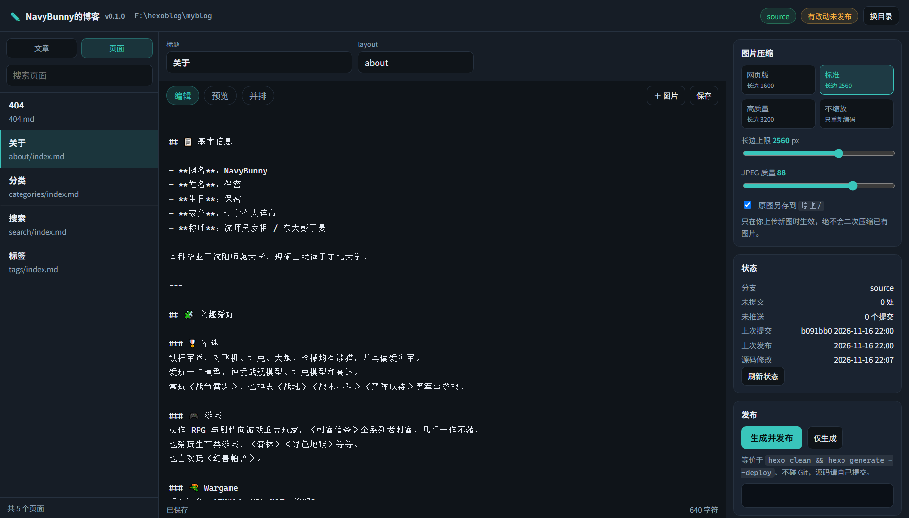

# hexo-post-studio

[](https://github.com/navybunny/hexo-post-studio/actions/workflows/ci.yml)
[](LICENSE)
[](#要求)

> 本地运行的 Hexo 图文发布工作台 —— Markdown 编辑、图片自动压缩、一键发布。

写图文博客最烦的两件事：**图片太大**（一张 10 MB 的相机原图直接拖进仓库）和**发布流程碎**（生成、部署、提交，还容易忘）。这个小工具把这两件事收进一个界面里。

### 👋 欢迎来看看我的博客

这个工具是给自家博客写的，里面长期有**胶片摄影、模型、Wargame 和一些计算机笔记** —— 喜欢的话欢迎来逛逛：

**<https://navybunny.github.io>**

它为什么长这样、中途砍掉了哪些功能，写在 [《我给自己写了个 Hexo 图文发布工作台》](https://navybunny.github.io/2026/11/17/hexo-post-studio/) 里了。



## 特点

- **本地跑，不联网**：`npx` 启动后在浏览器用，所有文件直接读写你本地的博客目录，不经过任何服务器。
- **文章 + 页面都能编辑**：除了 `source/_posts/` 的文章，`source/about/index.md` 这类页面也在同一个界面里改（关于页本来就要偶尔更新）。
- **拖图即压缩**：图片拖进编辑器 / `Ctrl+V` 粘贴，自动按你选的等级压缩，写入 `source/images/`，并把 Markdown 插到光标处。
- **一次拖入多张**：多个文件一起选/一起拖，按并发 3 张压缩，完成后按原顺序一次插入。
- **压缩等级可选**：网页版 1600 / 标准 2560 / 高质量 3200 / 不缩放，也可以自己拖滑块调长边和 JPEG 质量。
- **绝不二次压缩**：只压你新上传的图，已有文件一个都不动（这是画质杀手最常见的原因）。
- **支持扫描仪格式**：`.bmp` / `.tif` / `.tiff` 都能直接传，自动转成网页用的 JPEG（见下方说明）。
- **实时预览**：直接套用你博客主题的 CSS，所见接近所得。
- **撤回修改**：改坏了点一下「撤回修改」，恢复到上次提交的版本（当前内容会先备份，不会丢）。
- **状态一眼看清**：当前分支、未提交改动、未推送提交、**源码改过但还没发布**，都在顶栏。
- **一键发布**：内部就是 `hexo clean && hexo generate --deploy`，输出实时滚动，发完提醒你 Pages 还要等 1~2 分钟。
- **不碰 Git**：本工具只读 Git 状态、只调 hexo 命令，提交和推送永远由你自己决定。
- **可深链接**：刷新后停在原处，`#page=about/index.md` 这样的地址可以直接分享。

## 要求

- Node.js ≥ 20.3（这是 `sharp` 的要求；20 和 22 都测过）
- 一个 Hexo 博客目录（有 `_config.yml` 就行，主题随你用）

## 用法

```bash
# 直接跑，第一次会让你选博客目录
npx hexo-post-studio

# 或者指定目录
npx hexo-post-studio --dir ./my-hexo-blog

# 指定端口 / 不自动开浏览器
npx hexo-post-studio --port 5000 --no-open
```

启动后浏览器会打开 `http://127.0.0.1:4321/`。博客目录会被记住（存在 `~/.hexo-post-studio.json`）。

## 写一篇图文博客的流程

1. 点左上「＋ 新建」，填标题
2. 把图片**拖进编辑区**（或截图后 `Ctrl+V`）
   → 自动压缩 → 存进 `source/images/` → 在光标处插入 ``
3. 写完点「保存」（或 `Ctrl+S`）
4. 想看效果就切「预览」/「并排」
5. 点「生成并发布」

## 支持哪些图片格式

| 格式 | 上传 | 处理方式 |
|---|---|---|
| `.jpg` / `.jpeg` | ✅ | 重新编码为 JPEG |
| `.png` | ✅ | 有透明通道保持 PNG，否则转 JPEG |
| `.webp` | ✅ | 保持 WebP |
| **`.tif` / `.tiff`** | ✅ | — |
| **`.bmp`** | ✅ | — |
| `.gif` / `.avif` | ✅ | 静态转 JPEG；**动图原样保留**（不压成单帧） |

BMP 和 TIFF 一律转成 JPEG —— 扫描仪导出的这两种格式动辄几十 MB，网页上必须转。
BMP 尤其特殊：图像库 `sharp` 本身**不支持读 BMP**，所以内置了一个极简 BMP 解码器
（支持未压缩的 8/24/32 位），遇到 RLE 压缩会明确报错并提示你另存为 TIFF/PNG。

实测（1200×882 的胶片扫描）：

```
scan_test.bmp      3.03 MB → 236 KB  (7.6%)
scan_palette.bmp   1.01 MB → 233 KB  (22.5%)
scan_test.tif      3.03 MB → 236 KB  (7.6%)
```

## 关于「发布」和 Git

Hexo + GitHub Pages 的常见结构是**一个仓库两个分支**：

| 分支 | 内容 | 谁更新 |
|---|---|---|
| `source` | 源文件：`.md`、图片、主题、配置 | **你自己** `git push` |
| `main` | 生成出来的 HTML/CSS/JS | `hexo generate --deploy` |

所以完整发布是两步，本工具只做第二步：

```bash
# 本工具帮你做的
hexo clean && hexo generate --deploy      # 更新 main → 网站变了

# 你要自己做的（推荐每次发完都做一遍）
git add -A && git commit -m "..." && git push origin source
```

**为什么工具不自动提交？** 自动提交会把你的提交历史搅乱，而且提交粒度应该由你决定。工具会在顶栏用红色标出「N 处改动」「N 个未推送」，提醒你别忘了。

## 压缩等级怎么选

| 等级 | 长边 | 质量 | 适合 |
|---|---|---|---|
| 网页版 | 1600 px | 85 | 正文栏 800 px 左右的博客，2 倍屏也够 |
| 标准 | 2560 px | 88 | 想保留点余量、以后可能换布局 |
| 高质量 | 3200 px | 90 | 想让人放大看细节 |
| 不缩放 | 原尺寸 | 95 | 只想去掉元数据、重新编码 |

参考实测：一张 5148×3784、7.2 MB 的相机原图

- 长边 2560 / q88 → 约 354 KB（原图 4.8%）
- 长边 1600 / q82 → 约 123 KB（原图 1.7%）

## 数据与安全

- 配置只存在 `~/.hexo-post-studio.json`（博客目录、压缩偏好）
- 删除文章是**移到博客根目录的 `.post-studio-trash/`**，不是真删除
- 服务只监听 `127.0.0.1`，没有鉴权也没关系（只有本机能访问）
- 不做任何上传、不上报任何数据

## 兼容性

**不是只给某一个博客写的。** 已用一个和作者博客毫无共同点的结构实测过 —— `source_dir` 改成 `src`、主题是个不存在的名字、不是 git 仓库、全英文内容和文件名 —— **16 项检查全部通过**。

因为所有路径都从你的 `_config.yml` 读，所以下面这些都跟着你的配置走：

| 你的博客情况 | 工具表现 |
|---|---|
| `source_dir` 改成任意名字（如 `src`） | ✅ 正常识别 |
| `theme:` 指向任何主题，甚至主题没装 | ✅ 主题缺 CSS 时预览不套样式，其他功能照常 |
| `new_post_name: :year-:month-:day-:title.md` | ✅ 新建文章按你配置的格式命名 |
| 不是 git 仓库 | ✅ 能用，只是「撤回修改」和状态面板不可用（会明确提示） |
| 还没有 `source/images` 目录（新博客常见） | ✅ 第一次上传时自动创建 |
| 文章标题/文件名/内容是全中文 | ✅ 完整往返，注意 YAML 里日期要加引号 |
| 页面的 `layout` 是 `about` / `page` / 自定义 | ✅ 原样保留 |

## 已知限制

- **图片目录固定为 `<source_dir>/images`。** 用 `post_asset_folder`（每篇文章一个资源目录）或把图放别的目录的博客，工具会在 `source/images` 下建目录、并按 `/images/xxx.jpg` 插入链接
- **预览样式只从 `<theme>/source/css` 读 `.css`。** 主题把样式编译到别处时不套样式（不影响编辑和发布）
- **界面是中文**
- **发布要求博客目录里装了 Hexo**（`node_modules/hexo`），否则「生成并发布」会报错；只编辑不发布则不需要
- 没做移动端界面；Windows / macOS / Linux 都能跑

## 开发

```bash
git clone https://github.com/navybunny/hexo-post-studio.git
cd hexo-post-studio
npm install
npm start        # 起服务
npm test         # 自动化测试
```

**测试是自包含的**：`npm test` 会自己造一个临时 Hexo 博客、起服务、打接口、跑完把临时目录删掉 —— 不会碰你真实的博客目录，也不会联外网。

覆盖的内容：识别博客、中文标题与日期往返、front-matter 不重复、`new_post_name` 生效、`::: photo-grid` 预览转换、上传文件名清洗、重复图片去重、非 git 仓库的降级行为。

CI 在 GitHub Actions 上跑 **Windows 20/22 + macOS 22 + Ubuntu 20** 四个组合 —— 这个工具主要在 Windows 和 macOS 上用，两者都覆盖；`.github/workflows/ci.yml` 里可以看配置。

目录结构：

```
bin/cli.js          启动器（解析参数、起服务、开浏览器）
server/index.js     Express 路由
server/site.js      识别 Hexo 博客、读 _config.yml
server/posts.js     文章与页面读写、front-matter 解析、撤回修改
server/images.js    图片列表、压缩、未引用检查
server/bmp.js       极简 BMP 解码器（sharp 不支持读 BMP）
server/git.js       只读 Git 状态、源码/产物是否同步
server/publish.js   调 hexo 命令并流式输出
public/             前端（原生 JS，无框架）
docs/selftest-*.js  自测脚本（需要 node + 一个测试夹具）
```

自测脚本都是「起一个服务，然后打接口」的形式，可以用环境变量指定目标：

```bash
# 中文往返、多图上传、撤回、发布流
BASE_URL=http://127.0.0.1:4321 FIXTURE_DIR=/tmp/hps node docs/selftest.js
```

Windows PowerShell 用 `$env:BASE_URL='...'` 的形式设置。

## 相关链接

- 📝 **作者博客**：<https://navybunny.github.io> —— 胶片摄影、模型、Wargame 和计算机笔记
- ✍️ **开发记录**：[我给自己写了个 Hexo 图文发布工作台](https://navybunny.github.io/2026/11/17/hexo-post-studio/) —— 为什么做、中途砍了什么、踩了哪些坑
- 🐛 **问题 / 建议**：<https://github.com/navybunny/hexo-post-studio/issues>

## 许可证

[MIT](LICENSE)
